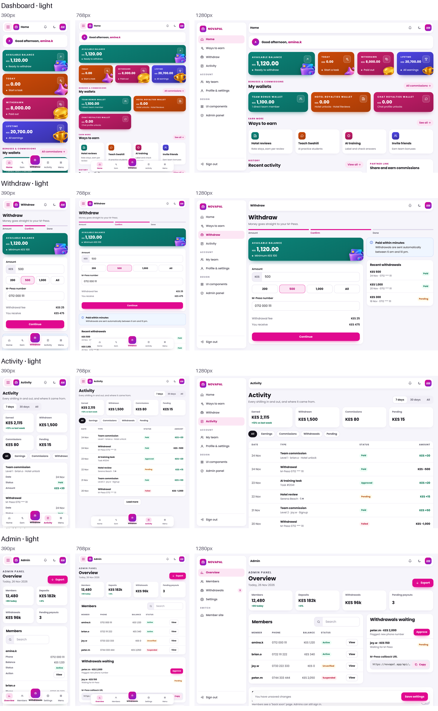
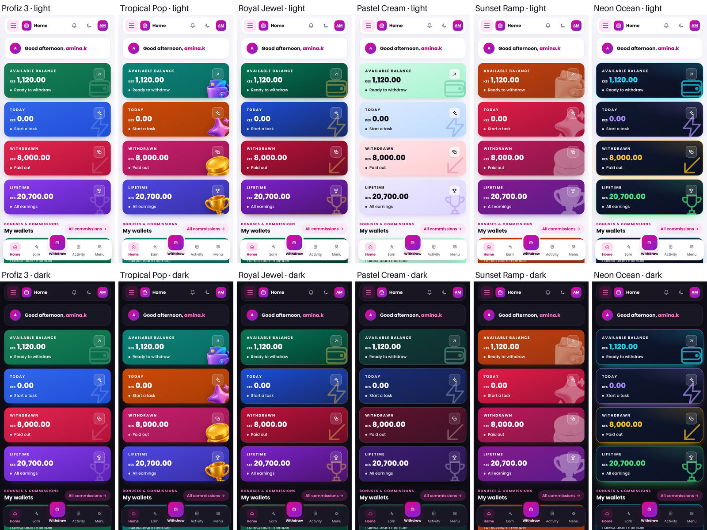

# Sunrise Dashboard UI — a Claude skill

Teach Claude to build **responsive member websites** — dashboards, sign-in / sign-up, withdraw, activity, tasks,
profile and admin panels — in the Sunrise / Profiz 3 style: phone → tablet → desktop (side rail), switchable
dashboard styles, six colour patterns, perfect light **and** dark mode, fast loading on 3G, link-preview pictures —
and to **show you screenshots as it builds**.




## What's inside

```
sunrise-dashboard-ui/
├── SKILL.md                      ← the skill (Claude reads this first)
├── references/                   ← detailed guides Claude opens when needed
│   ├── responsive.md             breakpoints, app shell (rail / drawer / tab bar), layout rules
│   ├── components.md             every component: markup, behaviour, accessibility
│   ├── pages.md                  recipes: dashboard, auth, withdraw, activity, tasks, profile, admin, more
│   ├── design-system.md          layout anatomy, tokens, typography, icons, navigation
│   ├── dashboard-styles.md       switchable styles ("skins"), file format, previews
│   ├── color-patterns.md         Profiz 3 + 5 patterns with exact colours and icon styles
│   ├── light-dark.md             rules and common dark-mode bugs
│   ├── speed.md                  fast pages on slow internet
│   ├── link-preview.md           favicon + WhatsApp / Facebook preview picture
│   ├── checks.md                 screenshots, contrast and overflow checks
│   └── forms-and-admin.md        register / login / admin page patterns
├── scripts/                      ← Python helpers (Playwright)
│   ├── gen_skin.py  patterns.py  contrast.py
│   ├── shots.py  contrast_audit.py  overflow_check.py  slow3g.py
└── assets/
    ├── starter/                  9 responsive pages + sunrise.css / sunrise.js / sr-boot.js (open index.html)
    ├── examples/skins/           skin source files for gen_skin.py
    └── php/                      asset-bundle.php · img-fit.php · share-head.php
```

## Install

**Claude (claude.ai / desktop app):** download `sunrise-dashboard-ui.zip` from the Releases page (or zip the
`sunrise-dashboard-ui` folder yourself) → Settings → Capabilities → Skills → *Upload skill*.

**Claude Code:** copy the folder into your skills directory:
```bash
git clone https://github.com/<you>/sunrise-dashboard-ui.git ~/.claude/skills/sunrise-dashboard-ui
```
(or into `.claude/skills/` inside a project to share it with your team).

**Scripts:** `pip install playwright pillow && playwright install chromium`

## Use

Just ask, for example:
- "Build a member dashboard for my earning app in the Profiz 3 style, show me as you create."
- "Add a new dashboard style using the Neon Ocean pattern with light and dark mode."
- "Make all my pages load fast on slow internet and show me before/after numbers."
- "Add a favicon and a link-preview picture for WhatsApp."

- "Make my withdraw and transactions pages work well on tablets and desktops."

Try the starter: serve the folder (`cd assets/starter && python3 -m http.server`) and open `index.html`,
`login.html`, `withdraw.html`, `transactions.html`, `tasks.html`, `profile.html`, `admin.html`, `components.html`.
Add `?p=neon&mode=dark` to any page (patterns: `profiz tropic jewel pastel sunset neon`).
Resize the window: the tab bar becomes a side rail at 1024 px.

## Upload this repo to GitHub

```bash
cd sunrise-dashboard-ui
git init && git add . && git commit -m "Sunrise Dashboard UI skill"
git branch -M main
git remote add origin https://github.com/<you>/sunrise-dashboard-ui.git
git push -u origin main
```
Or on github.com: **New repository** → *uploading an existing file* → drag the folder contents in → Commit.

## License
MIT — see `LICENSE`. The 3D icons in `assets/starter/i3d/` were generated for this project and are included
under the same licence.
